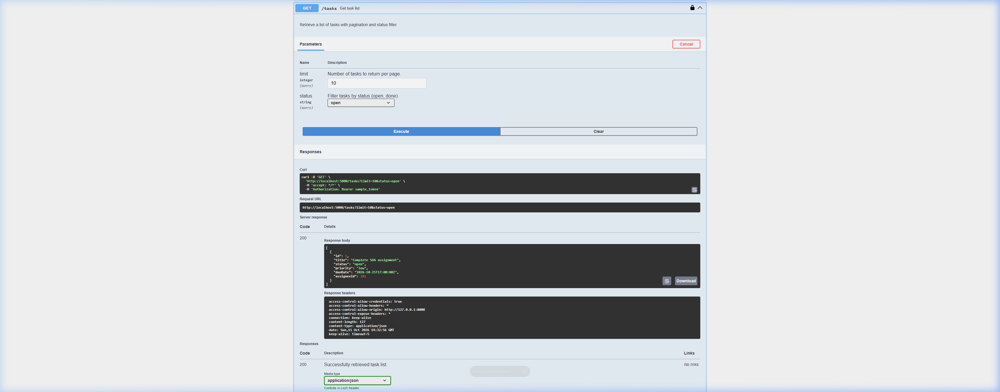
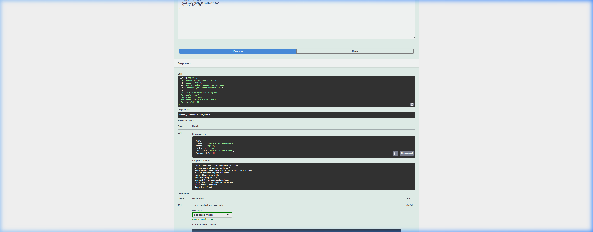
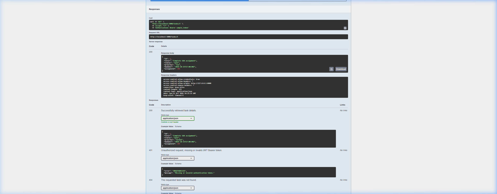
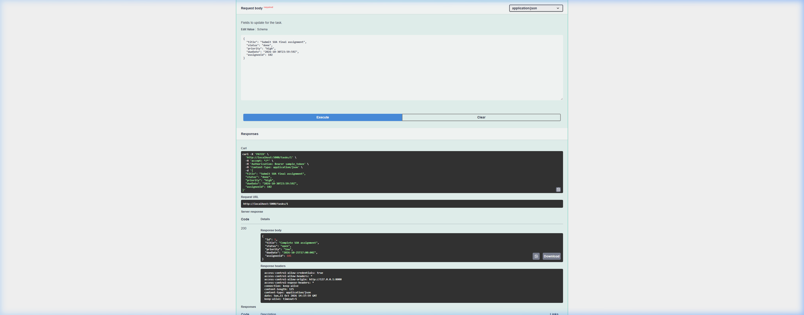
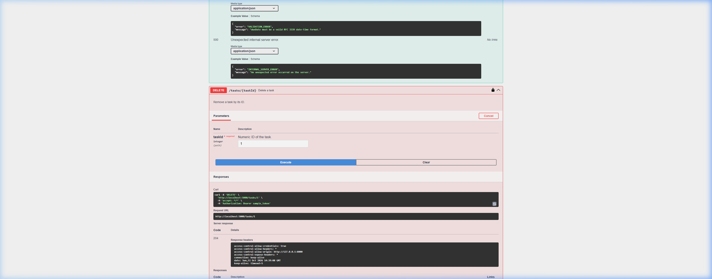

# Tasks Management API Specification

> **Môn học:** Kiến trúc hướng dịch vụ (INT3505E)  
> **Nhóm:** Group 4 - UET  
> **Phiên bản:** 1.0.0  
> **Chuẩn đặc tả:** OpenAPI 3.0.3 (YAML)

---

## 1. Giới thiệu tổng quan

Thư mục `tasks-api/` chứa toàn bộ tài liệu đặc tả, giao diện tương tác và minh chứng chạy thử cho dịch vụ quản lý công việc (**Tasks Service**). Tài liệu được xây dựng theo chuẩn RESTful API và OpenAPI 3.0.3, sẵn sàng tích hợp trong kiến trúc hướng dịch vụ (SOA / Microservices).

### Cấu trúc thư mục
```text
tasks-api/
├── openapi.yaml       # File đặc tả API chuẩn OpenAPI 3.0.3
├── swagger.html       # Giao diện Swagger UI tương tác trực tiếp (Try it out)
├── index.html         # Giao diện tài liệu Redoc trực quan
├── screenshots/       # Ảnh chụp minh chứng thực thi các endpoint
│   ├── 01_get_tasks.png
│   ├── 02_post_tasks.png
│   ├── 03_get_task_by_id.png
│   ├── 04_patch_task.png
│   └── 05_delete_task.png
└── README.md          # Tài liệu hướng dẫn và báo cáo kết quả
```

---

## 2. Hướng dẫn chạy thử nghiệm (Quick Start)

Dịch vụ hỗ trợ kiểm thử trực tiếp thông qua **Mock Server (Prism)** mà không cần cài đặt cơ sở dữ liệu:

### Bước 1: Khởi động Mock Server
Chạy lệnh sau tại thư mục gốc của dự án để khởi động máy chủ mock dữ liệu trên cổng `5000`:
```bash
npx -y @stoplight/prism-cli mock tasks-api/openapi.yaml -p 5000
```

### Bước 2: Khởi động Web Server để xem Swagger UI
Mở một terminal khác và chạy máy chủ web cục bộ:
```bash
python -m http.server 8000 --directory tasks-api
```

### Bước 3: Truy cập và xác thực
1. Truy cập trình duyệt tại: **[http://localhost:8000/swagger.html](http://localhost:8000/swagger.html)**
2. Nhấn nút **Authorize** (biểu tượng chiếc khóa 🔒 ở góc trên bên phải).
3. Nhập token bất kỳ (ví dụ: `sample_jwt_token`) rồi chọn **Authorize** $\rightarrow$ **Close**.
4. Chọn server trên cùng là: `http://localhost:5000 - Mock server (Prism)`.

---

## 3. Minh chứng chạy thử (Try It Out) của 5 Endpoints

---

### Endpoint 1: `GET /tasks` - Lấy danh sách công việc

* **Mục đích:** Lấy danh sách các task trong hệ thống, hỗ trợ tham số phân trang (`limit`) và lọc theo trạng thái (`status`).
* **Phương thức:** `GET`
* **Đường dẫn:** `/tasks`
* **Tham số query:**
  * `limit` (integer, mặc định: 10): Số lượng task tối đa trên một trang.
  * `status` (string, enum: `open`, `done`): Lọc task theo trạng thái.

#### Ảnh chụp minh chứng chạy thử (Try It Out):


#### Chú thích chi tiết kết quả:
* **Curl Request:** `curl -X 'GET' 'http://localhost:5000/tasks?limit=10&status=open' -H 'Authorization: Bearer sample_token'`
* **HTTP Status Code:** `200 OK`
* **Dữ liệu trả về (Response Body):** Một mảng JSON chứa danh sách các task khớp với điều kiện lọc:
  ```json
  [
    {
      "id": 1,
      "title": "Complete SOA assignment",
      "status": "open",
      "priority": "low",
      "dueDate": "2026-10-25T17:00:00Z",
      "assigneeId": 101
    }
  ]
  ```

---

### Endpoint 2: `POST /tasks` - Tạo mới một công việc

* **Mục đích:** Khởi tạo một task mới trong hệ thống.
* **Phương thức:** `POST`
* **Đường dẫn:** `/tasks`
* **Request Body (`CreateTaskInput`):**
  * `title`: Tiêu đề task (*bắt buộc*).
  * `dueDate`: Hạn hoàn thành chuẩn ISO 8601 (*bắt buộc*).
  * `assigneeId`: ID người nhận việc (*bắt buộc*).
  * `status`: Trạng thái ban đầu (mặc định: `open`).
  * `priority`: Độ ưu tiên `low`, `normal`, `high` (mặc định: `normal`).

#### Ảnh chụp minh chứng chạy thử (Try It Out):


#### Chú thích chi tiết kết quả:
* **Curl Request:** `curl -X 'POST' 'http://localhost:5000/tasks' -H 'Content-Type: application/json' -d '{ "title": "Complete SOA assignment", ... }'`
* **HTTP Status Code:** `201 Created`
* **Response Headers:** Trả về header `location: /tasks/1` trỏ đến đường dẫn của tài nguyên vừa tạo (chuẩn RESTful).
* **Dữ liệu trả về (Response Body):** Đối tượng `Task` hoàn chỉnh đã được server cấp phát `id: 1`.

---

### Endpoint 3: `GET /tasks/{taskId}` - Xem chi tiết công việc theo ID

* **Mục đích:** Tra cứu thông tin chi tiết của một task cụ thể thông qua định danh.
* **Phương thức:** `GET`
* **Đường dẫn:** `/tasks/{taskId}`
* **Tham số path:**
  * `taskId` (integer, bắt buộc): ID của task cần xem (ví dụ: `1`).

#### Ảnh chụp minh chứng chạy thử (Try It Out):


#### Chú thích chi tiết kết quả:
* **Curl Request:** `curl -X 'GET' 'http://localhost:5000/tasks/1' -H 'Authorization: Bearer sample_token'`
* **HTTP Status Code:** `200 OK`
* **Dữ liệu trả về (Response Body):** Chi tiết task có `id: 1` với đầy đủ các thuộc tính trạng thái, mức độ ưu tiên, hạn hoàn thành và người thực hiện.

---

### Endpoint 4: `PATCH /tasks/{taskId}` - Cập nhật một phần công việc

* **Mục đích:** Thay đổi một hoặc một vài trường thông tin của task mà không cần gửi lại toàn bộ đối tượng (khác với `PUT`).
* **Phương thức:** `PATCH`
* **Đường dẫn:** `/tasks/{taskId}`
* **Tham số path:**
  * `taskId` (integer): ID của task cần cập nhật (ví dụ: `1`).
* **Request Body (`UpdateTaskInput`):** Chỉ cần truyền các trường muốn thay đổi (ví dụ: sửa `status: "done"`, `priority: "high"`).

#### Ảnh chụp minh chứng chạy thử (Try It Out):


#### Chú thích chi tiết kết quả:
* **Curl Request:** `curl -X 'PATCH' 'http://localhost:5000/tasks/1' -H 'Content-Type: application/json' -d '{ "title": "Submit SOA final assignment", "status": "done", ... }'`
* **HTTP Status Code:** `200 OK`
* **Dữ liệu trả về (Response Body):** Đối tượng task sau khi đã áp dụng các thay đổi mới.

---

### Endpoint 5: `DELETE /tasks/{taskId}` - Xóa công việc

* **Mục đích:** Xóa vĩnh viễn một task khỏi hệ thống theo ID.
* **Phương thức:** `DELETE`
* **Đường dẫn:** `/tasks/{taskId}`
* **Tham số path:**
  * `taskId` (integer): ID của task cần xóa (ví dụ: `1`).

#### Ảnh chụp minh chứng chạy thử (Try It Out):


#### Chú thích chi tiết kết quả:
* **Curl Request:** `curl -X 'DELETE' 'http://localhost:5000/tasks/1' -H 'Authorization: Bearer sample_token'`
* **HTTP Status Code:** `204 No Content`
* **Ý nghĩa chuẩn RESTful:** Thao tác xóa thành công, server phản hồi mã `204` và không cần trả về nội dung (body rỗng), tối ưu băng thông mạng.

---

## 4. Mô hình dữ liệu chính (Data Schema)

| Tên trường | Kiểu dữ liệu | Bắt buộc | Mô tả | Ví dụ |
| :--- | :--- | :---: | :--- | :--- |
| **`id`** | integer | Có (khi đọc) | Định danh duy nhất của task do server cấp phát | `1` |
| **`title`** | string | Có | Tên / tiêu đề công việc | `"Complete SOA assignment"` |
| **`status`** | string | Có | Trạng thái công việc (`open`, `done`) | `"open"` |
| **`priority`** | string | Có | Mức độ ưu tiên (`low`, `normal`, `high`) | `"normal"` |
| **`dueDate`** | string (date-time) | Có | Thời hạn hoàn thành theo chuẩn RFC 3339 / ISO 8601 | `"2026-10-25T17:00:00Z"` |
| **`assigneeId`** | integer | Có | ID của thành viên được giao việc | `101` |

---

## 5. Quy chuẩn xử lý lỗi (HTTP Error Responses)

API chuẩn hóa toàn bộ phản hồi lỗi theo schema `ErrorResponse`:

```json
{
  "error": "MÃ_LỖI",
  "message": "Mô tả nguyên nhân lỗi bằng tiếng người"
}
```

* **`400 Bad Request`:** Lỗi cú pháp request hoặc sai định dạng tham số.
* **`401 Unauthorized`:** Chưa gửi token hoặc token JWT không hợp lệ.
* **`404 Not Found`:** Không tìm thấy task với `taskId` được chỉ định.
* **`422 Unprocessable Entity`:** Dữ liệu vi phạm ràng buộc nghiệp vụ (ví dụ định dạng ngày tháng sai).
* **`500 Internal Server Error`:** Lỗi phát sinh bất ngờ từ phía máy chủ.

---

## 6. Hai quyết định thiết kế khó nhất (Key Architectural Design Decisions)

Trong quá trình thiết kế API theo chuẩn Kiến trúc hướng dịch vụ (SOA) và RESTful, nhóm đã cân nhắc và đưa ra 2 quyết định thiết kế quan trọng và mang tính đánh đổi (trade-off) lớn nhất:

### Quyết định 1: Cơ chế cập nhật một phần (`PATCH`) và bài toán phân biệt "Giữ nguyên" vs "Xóa dữ liệu" (`undefined` vs `null`)

* **Bối cảnh & Đặt vấn đề:**
  Khi thiết kế endpoint cập nhật công việc, thay vì bắt buộc Client phải gửi lại toàn bộ đối tượng như `PUT`, nhóm quyết định sử dụng `PATCH /tasks/{taskId}` với schema `UpdateTaskInput` gồm các trường tùy chọn (optional). Tuy nhiên, điều này dẫn tới bài toán phân biệt ngữ nghĩa trong JSON:
  * **Trường hợp A (Giữ nguyên dữ liệu):** Client chỉ muốn đổi tiêu đề nên gửi `{"title": "Tên mới"}` $\rightarrow$ Server phải giữ nguyên `assigneeId`, `dueDate`, `priority` hiện có.
  * **Trường hợp B (Xóa trắng / Hủy giao việc):** Task đang có người thực hiện (`assigneeId: 101`), giờ người dùng muốn **hủy giao việc (unassign task)** $\rightarrow$ Client phải gửi `{"assigneeId": null}`.
* **Thách thức:**
  Trong nhiều ngôn ngữ lập trình backend và thư viện parse JSON, việc phân biệt giữa một trường **không được truyền lên** (`undefined` / missing key - nghĩa là *không thay đổi*) và một trường **được truyền với giá trị `null`** (nghĩa là *muốn reset/xóa dữ liệu*) thường bị gộp chung làm một, dễ dẫn đến lỗi vô tình xóa mất dữ liệu hoặc không cho phép client gỡ bỏ người được giao việc.
* **Giải pháp của nhóm:**
  Thiết kế `UpdateTaskInput` tách biệt với `CreateTaskInput`, không đặt trường nào là bắt buộc (`required`), đồng thời các trường có thể gỡ bỏ được khai báo rõ tính chất `nullable: true` trong schema OpenAPI để tầng backend có cơ chế xử lý phân biệt chính xác.

---

### Quyết định 2: Chiến lược Định danh (`Integer` vs `UUID`) & Ranh giới Dịch vụ (Service Boundary) với `assigneeId`

* **Bối cảnh & Đặt vấn đề:**
  Trong kiến trúc hướng dịch vụ (SOA / Microservices), dịch vụ **Tasks** và dịch vụ **Users / Accounts** là hai dịch vụ độc lập với cơ sở dữ liệu riêng biệt. Thuộc tính `assigneeId` là một khóa ngoại logic (Cross-service Foreign Key) liên kết giữa hai dịch vụ.
* **Thách thức & Đánh đổi (Trade-offs):**
  1. **Lựa chọn kiểu dữ liệu định danh (`id` & `assigneeId`):**
     * *Chọn `Integer` (tự tăng):* Rất trực quan cho đồ án môn học, URL ngắn gọn (`/tasks/1`), truy vấn và đánh chỉ mục (index) trong cơ sở dữ liệu nhanh; nhưng hạn chế khi hệ thống mở rộng phân tán và dễ bị lộ thông tin kinh doanh (tấn công dò quét IDOR).
     * *Chọn `UUID v4`:* Phù hợp tối đa cho hệ thống phân tán, không trùng lặp khi sharding; nhưng URL dài, tốn dung lượng lưu trữ hơn.
     * $\rightarrow$ **Lựa chọn:** Nhóm quyết định sử dụng kiểu `integer` để đảm bảo tính trực quan, gọn gàng và dễ giải trình trong phạm vi bài tập lớn.
  2. **Ràng buộc lỏng (Loose Coupling) giữa Tasks Service và Users Service:**
     * Khi gọi `POST /tasks`, Tasks Service có nên gọi đồng bộ (Synchronous HTTP/gRPC) sang Users Service để kiểm tra xem `assigneeId: 101` có thực sự tồn tại hay không?
       * Nếu **CÓ gọi kiểm tra đồng bộ**: Đảm bảo toàn vẹn dữ liệu chặt chẽ, nhưng tạo ra sự phụ thuộc chặt (**Tight Coupling**) — nếu Users Service gặp sự cố hoặc quá tải thì Tasks Service cũng sẽ không thể tạo được task.
       * Nếu **KHÔNG kiểm tra**: Đảm bảo tính độc lập (**Loose Coupling**) đúng nguyên lý SOA; nhưng chấp nhận rủi ro dữ liệu có thể trỏ tới người dùng không tồn tại nếu không có cơ chế bù đắp bất đồng bộ (như Event-Driven / Message Queue).
* **Ý nghĩa:**
  Quyết định này thể hiện sự thấu hiểu sâu sắc về nguyên lý độc lập dịch vụ, tính sẵn sàng (Availability) và tính nhất quán (Consistency) trong thiết kế hệ thống phân tán.

